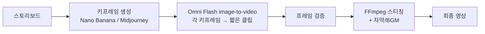

# Video Production Workflow Guide

이미지 생성 + Gemini 영상 생성을 결합한 짧은 영상 제작 워크플로우.

> **2026-11 갱신**: Gemini API의 Veo 3.1 preview(`veo-3.1-*`)는 **2026-10-22 종료**. 후속은 **Gemini Omni Flash** (`gemini-omni-1.2-flash`, Interactions API). GA Veo는 Gemini Enterprise Agent Platform에만 남음. 출처: [video](https://aistudio.google.com/docs/video) · [omni](https://aistudio.google.com/docs/omni) · [deprecations](https://aistudio.google.com/docs/deprecations). 모델 ID·가격은 바뀌기 쉬우니 작업 전 deprecations 페이지 확인.

## 모던 파이프라인



핵심 변화: 과거의 "키프레임 생성 → AI가 사이를 보간" 가정은 **Nano Banana 기능이 아닙니다**. 실제 모던 워크플로우는 **각 키프레임을 영상 모델(Omni Flash)로 짧은 클립화 → 스티칭**입니다. 두 컷 사이를 잇는 경우만 첫/끝 프레임 보간(3–10초)을 쓴다.

## Phase 1: 스토리보드 → 키프레임

각 컷의 키프레임을 이미지 생성 모델로 만든다. 일관성이 중요할수록 Nano Banana Pro(`gemini-3-pro-image`) 권장 (레퍼런스 최대 14장 중 인물 5·사물 6·스타일 3).

### 모델 선택

| 상황 | 모델 | 이유 |
|------|------|------|
| 빠른 컨셉 탐색 | NB 2.1 (`gemini-nano-banana-2.1`) 또는 Midjourney | 비용·속도 |
| 캐릭터·브랜드 일관성 필수 | **NB Pro** | 다중 레퍼런스 입력 |
| 텍스트·로고 포함 | **NB Pro** | 텍스트 렌더링 우수 |

### 히어로 샷 체크리스트

- [ ] 명확한 주인공 식별
- [ ] 환경/배경 확립
- [ ] 조명 방향 기록 (클립화 시 일관성 중요)
- [ ] 카메라 앵글 명시
- [ ] 종횡비 통일 (클립 간 통일)

## Phase 2: Omni Flash로 키프레임 → 영상 클립

각 키프레임 + 동작 프롬프트를 image-to-video로 클립화. 길이 3–15초(기본 10초), 네이티브 오디오.

### 기본 호출 (google-genai SDK, Interactions API)

```python
import base64
from google import genai

client = genai.Client()  # GEMINI_API_KEY 환경변수

interaction = client.interactions.create(
    model="gemini-omni-1.2-flash",
    input=[keyframe_image, "Camera slowly pans right as the character turns to face the viewer"],
    response_format={"type": "video", "duration": "8s"},  # 3s–15s, 정수 초
)
with open("clip.mp4", "wb") as f:
    f.write(base64.b64decode(interaction.output_video.data))
```

`input`에 이미지를 넣는 정확한 형식(파일 업로드·인라인 바이트)은 [omni 문서](https://aistudio.google.com/docs/omni)의 "Image to video generation" 예시를 그대로 따를 것 — 위 리스트 형식은 개략.

### 길이·레퍼런스 제약

| 항목 | 제약 |
|---|---|
| 길이 | 3–15초 (기본 10초). 15초 초과는 invalid argument |
| 레퍼런스 이미지 | 최대 6장 (캐릭터당 3장 × 최대 2명) |
| 첫/끝 프레임 보간 | 두 이미지 + 프롬프트, **3–10초만** |
| 다회 편집·연장 | Interactions API 멀티턴 |

> 가격은 AI Studio 문서의 pricing 페이지에서 확인 — 모델 교체로 Veo 시절 단가는 무효. **짧게 컨셉 확인 → 최종 길이로 렌더** 원칙은 그대로.

## Phase 3: 물리적 검증 체크리스트

영상 모델은 짧은 클립에서도 물리 오류를 낸다. 각 클립 검수:

### 즉시 재생성 필요 (Critical)
- [ ] 손가락 6개 이상, 비대칭 눈
- [ ] 떠있는 물체, 그림자 방향 불일치
- [ ] 캐릭터 ID 변형 (얼굴/의상이 클립 중간에 바뀜)

### 경미 — 후처리 가능 (Minor)
- [ ] 미세한 색상·조명 변화
- [ ] 배경 디테일 변화
- [ ] 의상 주름

### 검증 우선순위
1. 캐릭터 일관성 (최우선)
2. 물리 법칙 (중력·그림자·반사)
3. 스타일 일관성 (렌더링·색상 톤)

## Phase 4: 스티칭 & 후처리

여러 8초 클립을 FFmpeg로 이어붙이고 자막·BGM 합성.

### 기본 스티칭 (FFmpeg)

```bash
# concat list 작성
echo "file 'clip1.mp4'" > list.txt
echo "file 'clip2.mp4'" >> list.txt
echo "file 'clip3.mp4'" >> list.txt

ffmpeg -f concat -safe 0 -i list.txt -c copy output.mp4
```

### 클립 길이 가이드

| 동작 타입 | 클립 길이 |
|-----------|--------------|
| 짧은 표정·제스처 | 3–5초 |
| 카메라 무빙 | 8–10초 |
| 시퀀스 컷 | 클립 N개 + 스티칭 |

> 한 클립 최대 15초. 더 긴 영상은 여러 클립 + 스티칭(또는 멀티턴 연장)으로 구성.

## 트러블슈팅

### 캐릭터가 클립 중간에 변형됨
- **레퍼런스 이미지 입력**(최대 6장, 캐릭터당 3장) 활용
- 또는 키프레임을 NB Pro로 더 명확히 만들고 prompt에 캐릭터 디테일 명시

### 조명·색감이 클립 간 불일치
- 모든 키프레임을 같은 NB JSON 템플릿으로 생성 (`lighting`, `colorRestriction` 고정)
- 후처리 단계에서 FFmpeg color matching 적용

### 모션이 어색함
- prompt에 카메라/동작을 명시적으로 기술 ("slow pan right", "subject walks toward camera")
- 영상 모델은 자연어 prompt에 강함, JSON보다 자연어 권장

## 실전: 5초 인사 클립

1. **키프레임 1장**: NB Pro로 캐릭터 정면 무표정 생성
2. **클립 호출**: 위 기본 호출에 prompt `"Character smiles warmly, raises right hand, and waves at the camera. Soft natural lighting."`, `duration: "5s"`
3. **검증**: 손가락·표정 자연스러운지 확인

## 참고

- 첫 프로젝트는 1~3개 클립의 짧은 영상으로 시작 (비용 통제)
- 키프레임 + 영상 prompt + 결과물을 한 폴더에 같이 보관 (재현성)
- MCP보다 **API 직접 호출이 비용 통제·후처리 통합 측면에서 유리**

## 출처

- [Video generation - Google AI Studio docs](https://aistudio.google.com/docs/video) · [Omni](https://aistudio.google.com/docs/omni) · [Deprecations](https://aistudio.google.com/docs/deprecations) (2026-11-15 확인)
